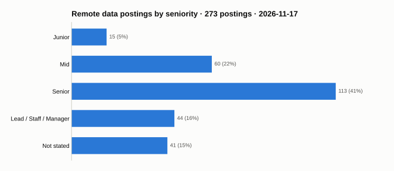
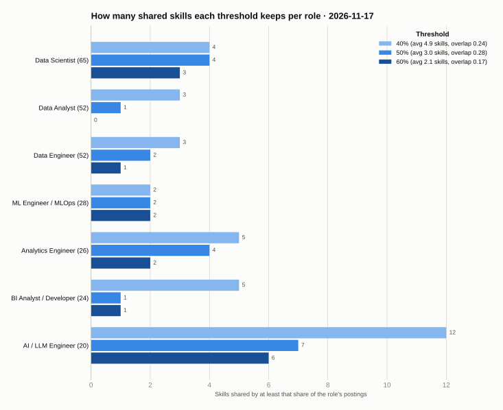
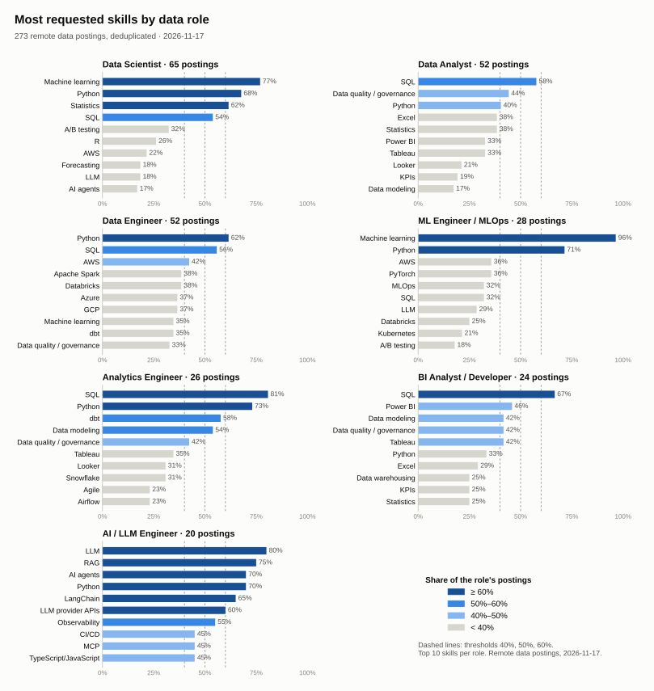

# job-finder

A small command-line tool that searches public job boards for **remote data roles** (data analyst,
data scientist, data/analytics engineer, ML/AI engineer, BI) and ranks them against **your own profile**:
skills, seniority, salary floor, location eligibility and language.

It produces a ranked report (Markdown + CSV) so you can spend your time reading and applying to the
postings that actually fit, instead of scrolling through hundreds that don't.

> **It never applies to anything.** The tool only reads public job APIs. Applying stays a manual,
> deliberate decision.

---

## Agent-first quick start

This repository is designed to be driven by an AI coding agent (Claude Code, Codex, OpenCode, Cursor...).
The agent's instructions live in [`AGENTS.md`](AGENTS.md) (`CLAUDE.md` imports it).

1. Clone the repository and open it with your agent.
2. Drop your resume (PDF, DOCX...) into [`your-resume/`](your-resume/).
3. Ask your agent: *"Find jobs that fit my resume"*. In Claude Code you can also run `/find-jobs`.

The agent will then:

1. install the dependencies if needed,
2. convert your resume to Markdown with [MarkItDown](https://github.com/microsoft/markitdown)
   (`python -m jobfinder.resume`),
3. read `your-resume/resume.md` and build your private `config.yaml` (skills, role families, experience),
4. ask you only what the resume cannot tell (salary floor, seniority, eligible regions, English level),
5. run the search (`python -m jobfinder`) and present the best matches with fit verdicts and gaps,
6. propose one filter change at a time if there are too few results.

The agent never applies to jobs and never commits your resume, config or reports.

Prefer doing it by hand? Follow [Installation](#installation) and [Usage](#usage) below.

---

## Table of contents

- [Agent-first quick start](#agent-first-quick-start)
- [Why this exists](#why-this-exists)
- [What it does](#what-it-does)
- [What it does not do](#what-it-does-not-do)
- [Requirements](#requirements)
- [Installation](#installation)
- [Configuration](#configuration)
- [Usage](#usage)
- [What to expect](#what-to-expect)
- [How a posting is scored](#how-a-posting-is-scored)
- [Remote data job market](#remote-data-job-market)
- [Sources](#sources)
- [Privacy: what is never committed](#privacy-what-is-never-committed)
- [Security notes](#security-notes)
- [Troubleshooting](#troubleshooting)
- [Project structure](#project-structure)
- [Tests](#tests)

---

## Why this exists

Remote job boards mix thousands of postings: senior-only roles, "US only" positions, jobs paying far below
your expectations, or roles requiring a level of English you don't have. Filtering that by hand every week
is slow and error-prone.

`job-finder` automates the boring part: it collects postings from several sources, discards what clearly
does not fit, and scores the rest so the best matches are at the top.

## What it does

1. **Collects** postings from public job-board APIs and from the public career pages (ATS) of selected
   companies, and **removes duplicates** (the same posting found in several sources or queries).
2. **Filters out** postings that are:
   - not data roles,
   - above your seniority (Senior, Lead, Staff, Principal, Manager...) or require too many years of
     experience,
   - not remote, or restricted to regions you cannot work from (e.g. "US only"),
   - older than a configurable number of days,
   - paying below your salary floor (when the salary is published).
3. **Scores** the remaining ones from 0 to 100 based on skill match, seniority fit, salary, location and
   language.
4. **Writes** a ranked report to `output/`.

### Features at a glance

| Feature | What you get | Details |
|---|---|---|
| Ranked matches | Postings that pass every filter, best first | [How a posting is scored](#how-a-posting-is-scored) |
| Missing skills per posting | For each match: the skills it asks for that your profile lacks, to prepare before applying | [Missing skills per posting](#missing-skills-per-posting) |
| Near misses | Postings blocked by a single, negotiable detail ("Senior" title, 6 years instead of 5...) | [Near misses](#near-misses) |
| Skill gaps | The skills the market asks for most that your profile does not list | [Skill gaps](#skill-gaps) |
| New since last run | `new` flag on postings you have not seen before | [What to expect](#what-to-expect) |
| Market snapshot | Remote data postings by seniority and by role, with each role's most requested skills | [Remote data job market](#remote-data-job-market) |
| Agent-first workflow | Your AI agent converts your resume, builds your profile and runs everything | [Agent-first quick start](#agent-first-quick-start) |
| Never applies | Read-only: applying is always your decision | [What it does not do](#what-it-does-not-do) |

## What it does not do

- It does **not** submit applications, fill forms, or log into any site.
- It does **not** scrape LinkedIn/Indeed by default (that integration exists but is disabled, see
  [Sources](#sources)).
- It does **not** send your CV or profile anywhere. Your profile lives only in a local config file and
  is used only to filter results on your machine.
- It does **not** guarantee a posting is legitimate. Always verify the company before sharing personal data.

## Requirements

| Requirement | Version | Notes |
|---|---|---|
| Python | 3.10 or newer | Tested with 3.11 |
| pip | any recent | To install dependencies |
| Internet access | — | Only outgoing HTTPS GET requests to the sources listed below |
| Git | optional | Only if you version the project |

Python dependencies (see `requirements.txt`): `requests`, `PyYAML`, `markitdown[pdf,docx]` (resume
conversion), and `pytest` for the tests. No API keys or accounts are needed.

## Installation

```bash
# 1. Get the code
git clone <your-repo-url> job-finder
cd job-finder

# 2. (Recommended) create a virtual environment
python -m venv .venv
# Windows (PowerShell)
.venv\Scripts\Activate.ps1
# macOS / Linux
source .venv/bin/activate

# 3. Install dependencies
pip install -r requirements.txt

# 4. Create your private configuration
# Windows (PowerShell)
Copy-Item config.example.yaml config.yaml
# macOS / Linux
cp config.example.yaml config.yaml
```

Then edit `config.yaml` with your own profile (next section).

## Configuration

All your personal criteria live in `config.yaml`, which is **git-ignored**. `config.example.yaml` is the
committed template and contains no personal data. All patterns are case-insensitive Python regular
expressions.

| Section | What you set | Example |
|---|---|---|
| `profile.skills` | Your skills and how much each one matters (weight) | `python: 3`, `power bi: 3`, `llms?: 2` |
| `filters.title_include` / `title_exclude` | Which job titles count as data roles | `'\bdata\b'`, `'analytics'` |
| `filters.seniority` | Levels you accept / reject, max years of experience required | accept `junior`, `semi senior`; reject `senior`, `lead` |
| `filters.location` | Regions you can legally work from, preferred regions, blocked phrases | allowed `latam`, `worldwide`; blocked `US only` |
| `filters.salary` | Monthly USD floor, target, approximate FX rates | `min_monthly_usd: 3000` |
| `filters.language` | Phrases that signal demanding English, and whether to reject or just penalize | `fluent english`, `\bC1\b` |
| `scoring` | Relative weight of each scoring dimension | `skills: 40` |
| `sources` | Which sources are enabled and their parameters (categories, company slugs...) | `greenhouse: {companies: [gitlab]}` |
| `output` | Report folder, how many rows in the Markdown report, minimum score | `top_n: 40` |
| `near_miss` | How close a posting must be to count as a near miss | `max_extra_years: 2` |
| `insights` | Skills catalog path, how many near misses and gaps to show, new-posting tracking | `gaps_top_n: 15` |

Tips:

- **Salary** is compared in USD per month. Yearly salaries are divided by 12, hourly ones multiplied by
  `hours_per_month`. Other currencies use the approximate rates in `fx_to_usd`; update them occasionally.
- **"Semi Senior" is mid level.** The example patterns are written so it is not rejected as "Senior".
- **Adding companies:** pick remote-friendly companies from
  [remoteintech/remote-jobs](https://github.com/remoteintech/remote-jobs) or
  [matildaexp/remote-latam](https://github.com/matildaexp/remote-latam), find their careers page URL and
  add the slug to the matching ATS:
  - `boards.greenhouse.io/<slug>` or `job-boards.greenhouse.io/<slug>` → `sources.greenhouse.companies`
  - `jobs.lever.co/<slug>` → `sources.lever.companies`
  - `jobs.ashbyhq.com/<slug>` → `sources.ashby.companies`
  - `apply.workable.com/<slug>` → `sources.workable.companies`

## Usage

```bash
python -m jobfinder.resume                  # convert your-resume/<file> to your-resume/resume.md
python -m jobfinder                         # uses ./config.yaml
python -m jobfinder --config other.yaml     # use another config file
python -m jobfinder -v                      # verbose logging
python -m jobfinder.market                  # market snapshot (independent of your profile)
python -m jobfinder.market --min-share 0.6  # only list skills present in 60%+ of a role's postings
python -m jobfinder.market --thresholds 0.4,0.5,0.6 --charts docs/market   # compare thresholds + SVG charts
```

On Windows, if accented characters look broken in the console, run
`$env:PYTHONIOENCODING = "utf-8"` first. The report files themselves are always UTF-8.

## What to expect

- **Run time:** roughly 1 to 3 minutes, depending on how many sources and companies are enabled. The tool
  waits a little between requests to be polite with free APIs and retries transient errors.
- **Console output:** how many postings each source returned, then the totals and the report paths:

  ```text
  remotive       32 postings
  jobicy         78 postings
  himalayas     360 postings
  ...
  1762 fetched, 8 kept. Reports:
    output/jobs-20261117-1602.csv
    output/jobs-20261117-1602.md
  ```

- **Reports** in `output/`:
  - `jobs-<date>.md` with four sections:
    1. **Matches**: the top postings as a table (score, role, company, location, USD/month, flags,
       missing skills, link). See [Missing skills per posting](#missing-skills-per-posting).
    2. **Near misses**: postings that failed a single *soft* filter by a small margin, with the blocker and
       their missing skills. See [Near misses](#near-misses).
    3. **Skill gaps**: skills that eligible postings ask for and your profile does not list. See
       [Skill gaps](#skill-gaps).
    4. **Rejected by reason**: how many postings each filter removed.
  - `jobs-<date>.csv`: every kept posting with matched skills, missing skills, source and publication date.
    Opens in Excel (UTF-8 with BOM).
  - `seen.json`: postings seen in previous runs, used to flag new ones (see `insights.track_new`).
  - `market-<date>.md`: written by `python -m jobfinder.market` (see [Remote data job market](#remote-data-job-market)).
- **Flags** in the report:

  | Flag | Meaning |
  |---|---|
  | `new` | Not seen in previous runs (kept for `insights.new_retention_days` days) |
  | `latam-friendly` | Location explicitly names one of your preferred regions |
  | `junior/mid` | Title or source level matches an accepted seniority |
  | `spanish` | Posting is written in Spanish |
  | `english-demanding` | Asks for fluent/native/C1+ English (penalized, not removed) |
  | `salary-unknown` | No salary published; kept so you can ask |
  | `ask-for-more` | Published range goes above your target: negotiate up |

- **Few results is normal.** Most remote data postings are senior or region-restricted. The
  "Rejected by reason" section tells you which filter removes the most, so you can decide whether to
  relax it (for example `max_years_required` or `max_age_days`) or add more companies.
- **One source failing does not stop the run.** It is logged as a warning and the rest continue.

## How a posting is scored

Every posting goes through all the filters below. A posting is a match only if it fails none; the first failure is
the one counted in "Rejected by reason". Filters are *hard* (the posting can never fit) or *soft* (it may be
negotiable):

| # | Filter | Config | Type |
|---|---|---|---|
| 1 | Data role | `title_include` / `title_exclude` | hard (non-data roles are discarded right away) |
| 2 | Seniority | `reject_title`, `reject_hint`, `max_years_required` | soft for a plain "Senior"/"Sr." and for a few extra years; hard for lead/staff/principal/manager... |
| 3 | Location | remote, allowed regions, blocked phrases | hard |
| 4 | Freshness | `max_age_days` | hard |
| 5 | Salary floor | `min_monthly_usd` (only if a salary is published) | soft when close to the floor |
| 6 | Language | `reject_english_demanding` | soft |

Every data role gets a score from 0 to 100 (so near misses can be ranked too):

| Dimension | Full points when | Partial points when |
|---|---|---|
| Skills | The posting mentions enough of your weighted skills (`match_saturation`) | Proportional to matched skills |
| Seniority | Title/level explicitly matches an accepted level | Level not stated |
| Salary | Published and above the floor | Not published |
| Location | Preferred region named | Other allowed or neutral location |
| Language | Spanish posting | English without demanding requirements (lower if demanding) |

Postings below `output.min_score` are not shown.

### Duplicates

The same posting often comes back several times: from overlapping queries of one source (Himalayas returns it for
"data analyst" and for "data scientist") and from different sources (a company's Lever page and Himalayas).
Postings are merged when their **normalized company and title** match, keeping the best-scored copy:

- Company: case, spaces, punctuation, accents and legal suffixes are ignored, so `Mutt Data`, `muttdata` and
  `MuttData Inc.` are one company, and so are `Grafana Labs` and the slug `grafanalabs`.
- Title: case, punctuation, accents and the words "remote"/"remoto" are ignored, so `Data Engineer (Remote)` and
  `data engineer` are one posting. Different titles stay different (`Data Engineer` vs `Senior Data Engineer`).

The same rule is used everywhere: matches, near misses, skill gaps, the market snapshot and new-posting tracking.
In a test run, 1,948 fetched postings (1,619 distinct URLs) became 1,560 unique postings.

### Near misses

A near miss failed **exactly one soft filter, by a small margin**, and no hard filter:

| Blocker | Counts as near miss when | Config (`near_miss`) |
|---|---|---|
| Plain "Senior" / "Sr." title, or source level "Senior" | always (never lead, staff, principal, manager...) | `include_senior_titles` |
| Years of experience required | up to `max_years_required` + `max_extra_years` | `max_extra_years` (default 2) |
| Salary below the floor | at least `min_monthly_usd` × (1 − `salary_tolerance`) | `salary_tolerance` (default 0.15) |
| Advanced English (if you chose to reject it) | always | — |

The top `insights.near_miss_top_n` are listed by score. They are worth reading: "5+ years" with 4.5 years of
experience, or a "Senior" title at a LATAM company, is often negotiable.

### Skill gaps

[`skills_catalog.yaml`](skills_catalog.yaml) is a generic catalog of ~130 data, ML, GenAI, cloud and BI skills. It
was written by hand and then extended with the most frequent tools found in ~435 scraped data postings. For every
**eligible** posting (data role, eligible location, any seniority, deduplicated), the tool checks which catalog skills
it mentions, keeps those that are **not** covered by your `profile.skills`, and ranks them by how many postings ask
for them.

- A catalog skill is covered when one of your `profile.skills` keys matches its name (for example the key `llms?`
  covers `LLM`).
- A gap can mean you lack the skill **or** that your profile forgot it. If a "gap" is on your resume, add it to
  `profile.skills`.
- Tune it with `insights.gaps_top_n` and `insights.gaps_min_count`, or extend the catalog with the tools of your niche.

Example of the section (illustrative numbers):

| Skill | Postings | Share |
|---|---|---|
| Databricks | 25 | 23% |
| CI/CD | 25 | 23% |
| LangChain | 18 | 17% |
| Apache Spark | 17 | 16% |

Read it as a learning backlog: the higher the share, the more doors that skill opens.

### Missing skills per posting

Skill gaps are the big picture; when you are about to **apply**, what matters is the specific posting. Every match and
every near miss has a **Missing skills** column: the catalog skills that posting mentions and your profile does not
list (up to five, then `(+N)`; the CSV has the full list). `—` means the posting asks for nothing you lack.

Example (illustrative):

| Score | Role | Company | ... | Missing skills | URL |
|---|---|---|---|---|---|
| 81.7 | Data Engineer, AI & Analytics | Acme Analytics | ... | Snowflake, CI/CD, Data quality / governance (+2) | https://... |
| 80.5 | AI Scientist (LATAM) | Example Labs | ... | Apache Spark, A/B testing | https://... |
| 74.0 | Data Analyst | Sample Co | ... | — | https://... |

How to use it before applying:

1. **One or two missing skills** are normal. Prepare a short, honest answer for each ("I haven't used Snowflake in
   production; I work daily with BigQuery, which covers the same warehouse concepts").
2. **Adjacent skills** you already have (BigQuery for Snowflake, Power BI for Tableau) are worth naming in your cover
   letter or first call.
3. **Many missing skills** usually mean a different role family than yours: check the score and the near-miss
   blocker before investing time.
4. If a "missing" skill is actually on your resume, add it to `profile.skills`: your profile forgot it.

## Remote data job market

`python -m jobfinder.market` classifies **every remote data posting** returned by the enabled sources, regardless of
your profile, and writes `output/market-<date>.md`: postings by seniority, by role, and the skills each role asks
for. Use it to see where the market is and which skills each role expects.

**How it is built**

- *Remote*: the source marks the posting as remote, or its location says remote/anywhere/worldwide. This includes
  remote positions restricted to one country.
- *Data role*: the title is classified into a role family (Data Analyst, Data Scientist, Data Engineer, Analytics
  Engineer, ML Engineer / MLOps, AI / LLM Engineer, BI, Data Architect, Data Governance). Titles that only mention
  data or AI (sales, product management, data-labeling gigs, data-center engineering) are excluded.
- *Seniority*: from the title ("Senior", "Lead", "Semi Senior", "II"...), falling back to the level the source
  reports; otherwise "Not stated".
- *Skills*: catalog skills mentioned in the posting; a skill is listed for a role when it appears in at least
  `--min-share` of that role's postings (default 40%).
- Postings are deduplicated (see [Duplicates](#duplicates)).

**Limits.** This is a snapshot of the enabled sources, not of the whole market: it leans towards remote-first job
boards and the companies in your config, and it changes week to week. Skill detection is keyword-based, so a skill a
posting implies but does not name is not counted.

### Snapshot: 17 Nov 2026 (2026-11-17)

**273 remote data postings** (deduplicated), collected on 2026-11-17. The aggregated numbers are saved in
[`docs/market/snapshot-2026-11-17.json`](docs/market/snapshot-2026-11-17.json) (no postings, only counts and shares),
so the charts can be regenerated without fetching again.

**Sources and search criteria**

| Source | What was queried |
|---|---|
| Remotive | categories `data`, `artificial-intelligence` |
| Jobicy | industry `data-science`; regions: any, `latam`, `argentina` |
| Himalayas | searches: data analyst, data scientist, data engineer, machine learning, analytics engineer, business intelligence (3 pages each) |
| RemoteOK | tags `data`, `analyst`, `machine-learning` |
| Get on Board | categories `data-science-analytics`, `machine-learning-ai` (3 pages each) |
| Greenhouse | GitLab, Wizeline, Canonical, Grafana Labs |
| Lever | Toptal, Mutt Data, Despegar |
| Ashby | Supabase, PostHog, n8n, Airbyte |
| Workable | Platzi |

Criteria applied to every posting:

- **Remote**: marked remote by the source, or "remote/anywhere/worldwide" in its location (country-restricted remote
  included).
- **Data role**: the title maps to one of the role families below; sales, product, data-labeling and data-center
  titles are excluded.
- **Deduplicated** across sources and queries by normalized company and title.
- **Skills**: the 127 skills of [`skills_catalog.yaml`](skills_catalog.yaml), matched as keywords in title and
  description.
- **Shared skill**: a skill counts for a role when it appears in at least *X%* of that role's postings. Roles with
  fewer than 5 postings are not detailed (Data Architect, Data Governance and "other" had 1 to 4).
- Machine Learning and MLOps titles are grouped as **ML Engineer / MLOps**: MLOps-only titles were too few to stand
  alone.

#### Postings by seniority

<picture>
  <source media="(prefers-color-scheme: dark)" srcset="docs/market/seniority-dark.svg">
  
</picture>

| Seniority | Postings | Share |
|---|---|---|
| Junior | 15 | 5% |
| Mid | 60 | 22% |
| Senior | 113 | 41% |
| Lead / Staff / Manager | 44 | 16% |
| Not stated | 41 | 15% |

Senior roles dominate (41%); only 1 in 20 remote data postings is explicitly junior.

#### Which threshold segments skills best: 40%, 50% or 60%?

Each threshold was applied to the same 273 postings. A good threshold leaves every role with a short list of skills
(3 to 6) that is **its own**, not the same list for every role.

<picture>
  <source media="(prefers-color-scheme: dark)" srcset="docs/market/skills-per-threshold-dark.svg">
  
</picture>

| Threshold | Avg shared skills per role | Roles left with no skill | Overlap between roles (mean Jaccard) |
|---|---|---|---|
| **40%** | **4.9** | **0** | **0.24** |
| 50% | 3.0 | 0 | 0.28 |
| 60% | 2.1 | 1 (Data Analyst) | 0.17 |

- **60%** has the lowest overlap only because the lists shrink to 1 or 2 skills (Python, SQL): Data Analyst keeps
  nothing, and Data Engineer and BI keep a single skill. Too strict to describe a role.
- **50%** collapses Data Analyst and BI to just *SQL*, so it cannot tell them apart, and overlap goes up (0.28).
- **40%** gives every role 2 to 5 skills (AI / LLM Engineer: 12), none empty, with less overlap than 50%. **It is the
  threshold that segments best**, and the default of `python -m jobfinder.market`.

#### Shared skills by role

<picture>
  <source media="(prefers-color-scheme: dark)" srcset="docs/market/skills-by-role-dark.svg">
  
</picture>

Bars are colored by band: **≥ 60%** darkest, 50–60% medium, 40–50% light, below 40% gray.

At **40%** (recommended):

| Role | Postings | Shared skills (share of the role's postings) |
|---|---|---|
| Data Scientist | 65 | Machine learning (77%), Python (68%), Statistics (62%), SQL (54%) |
| Data Analyst | 52 | SQL (58%), Data quality / governance (44%), Python (40%) |
| Data Engineer | 52 | Python (62%), SQL (56%), AWS (42%) |
| ML Engineer / MLOps | 28 | Machine learning (96%), Python (71%) |
| Analytics Engineer | 26 | SQL (81%), Python (73%), dbt (58%), Data modeling (54%), Data quality / governance (42%) |
| BI Analyst / Developer | 24 | SQL (67%), Power BI (46%), Data modeling (42%), Data quality / governance (42%), Tableau (42%) |
| AI / LLM Engineer | 20 | LLM (80%), RAG (75%), AI agents (70%), Python (70%), LangChain (65%), LLM provider APIs (60%), Observability (55%), CI/CD (45%), MCP (45%), TypeScript/JavaScript (45%), Azure (40%), GCP (40%) |

<details>
<summary>At 50% and 60%</summary>

| Role | At 50% | At 60% |
|---|---|---|
| Data Scientist | Machine learning, Python, Statistics, SQL | Machine learning, Python, Statistics |
| Data Analyst | SQL | — |
| Data Engineer | Python, SQL | Python |
| ML Engineer / MLOps | Machine learning, Python | Machine learning, Python |
| Analytics Engineer | SQL, Python, dbt, Data modeling | SQL, Python |
| BI Analyst / Developer | SQL | SQL |
| AI / LLM Engineer | LLM, RAG, AI agents, Python, LangChain, LLM provider APIs, Observability | LLM, RAG, AI agents, Python, LangChain, LLM provider APIs |

</details>

In one line per role (40%):

- **Data Analyst:** SQL, data quality, Python (then Excel and statistics at 38%, Power BI and Tableau at 33%).
- **BI Analyst / Developer:** SQL, Power BI, Tableau, data modeling, data quality.
- **Data Engineer:** Python, SQL, AWS (then Spark and Databricks at 38%, Azure and GCP at 37%).
- **Analytics Engineer:** SQL, Python, dbt, data modeling, data quality.
- **Data Scientist:** machine learning, Python, statistics, SQL.
- **ML Engineer / MLOps:** machine learning, Python (then AWS and PyTorch at 36%, MLOps at 32%).
- **AI / LLM Engineer:** LLMs, RAG, AI agents, Python, LangChain, LLM provider APIs: the most specific and most
  demanding profile, with no junior or mid openings in this snapshot.

#### Seniority by role

| Role | Junior | Mid | Senior | Lead / Staff / Manager | Not stated |
|---|---|---|---|---|---|
| Data Scientist | 4 | 14 | 28 | 8 | 11 |
| Data Analyst | 8 | 8 | 10 | 9 | 17 |
| Data Engineer | 0 | 14 | 24 | 9 | 5 |
| ML Engineer / MLOps | 1 | 6 | 13 | 5 | 3 |
| Analytics Engineer | 0 | 4 | 18 | 3 | 1 |
| BI Analyst / Developer | 2 | 14 | 2 | 4 | 2 |
| AI / LLM Engineer | 0 | 0 | 15 | 3 | 2 |

Data Analyst and BI are the most accessible families below senior level; Analytics Engineer and AI / LLM Engineer
are almost entirely senior.

#### Reproduce or refresh

```bash
pip install matplotlib   # only needed for --charts
python -m jobfinder.market --thresholds 0.4,0.5,0.6 \
  --save-snapshot docs/market/snapshot-<date>.json --charts docs/market
# Regenerate the charts from a saved snapshot, without fetching:
python -m jobfinder.market --from-snapshot docs/market/snapshot-2026-11-17.json --thresholds 0.4,0.5,0.6 --charts docs/market
```

Numbers change with every run: sources add and remove postings daily.

## Sources

| Source | Endpoint | Notes |
|---|---|---|
| Remotive | `remotive.com/api/remote-jobs` | Public API, filter by category |
| Jobicy | `jobicy.com/api/v2/remote-jobs` | Supports `geo=latam` / `geo=argentina` |
| Himalayas | `himalayas.app/jobs/api/search` | 20 results per page, paginated |
| RemoteOK | `remoteok.com/api` | Attribution required if you republish data |
| Get on Board | `getonbrd.com/api/v0` | LATAM-focused, many postings in Spanish |
| Greenhouse | `boards-api.greenhouse.io/v1/boards/<slug>/jobs` | Official public job-board API |
| Lever | `api.lever.co/v0/postings/<slug>` | Official public postings API |
| Ashby | `api.ashbyhq.com/posting-api/job-board/<slug>` | Official public job-board API |
| Workable | `apply.workable.com/api/v1/widget/accounts/<slug>` | Public careers widget API |
| JobSpy (**disabled**) | `python-jobspy` package | Scrapes LinkedIn/Indeed; may violate their terms and get your IP blocked |

To enable JobSpy, install it explicitly with `pip install python-jobspy` (**not** `jobspy`, which is an
unrelated package) and set `sources.jobspy.enabled: true`.

### Job boards queried

| Board | Focus | Parameters used by default |
|---|---|---|
| [Remotive](https://remotive.com) | Remote jobs worldwide | categories `data`, `artificial-intelligence` |
| [Jobicy](https://jobicy.com) | Remote jobs, filterable by region | industry `data-science`; geos: any, `latam`, `argentina` |
| [Himalayas](https://himalayas.app) | Remote jobs with salary and seniority data | queries: data analyst, data scientist, data engineer, machine learning, analytics engineer, business intelligence |
| [RemoteOK](https://remoteok.com) | Remote jobs worldwide | tags `data`, `analyst`, `machine-learning` |
| [Get on Board](https://www.getonbrd.com) | LATAM tech jobs, many in Spanish | categories `data-science-analytics`, `machine-learning-ai` |

### Company career portals (ATS)

These slugs were checked against the public APIs at the time of writing. Companies change ATS or close
boards, so a slug that starts returning 404 should be removed or updated.

| Company | ATS | Slug | Careers page |
|---|---|---|---|
| GitLab | Greenhouse | `gitlab` | https://job-boards.greenhouse.io/gitlab |
| Wizeline | Greenhouse | `wizeline` | https://job-boards.greenhouse.io/wizeline |
| Canonical | Greenhouse | `canonical` | https://job-boards.greenhouse.io/canonical |
| Grafana Labs | Greenhouse | `grafanalabs` | https://job-boards.greenhouse.io/grafanalabs |
| Toptal | Lever | `toptal` | https://jobs.lever.co/toptal |
| Mutt Data | Lever | `muttdata` | https://jobs.lever.co/muttdata |
| Despegar | Lever | `despegar` | https://jobs.lever.co/despegar |
| Platzi | Workable | `platzi` | https://apply.workable.com/platzi |
| Supabase | Ashby | `supabase` | https://jobs.ashbyhq.com/supabase |
| PostHog | Ashby | `posthog` | https://jobs.ashbyhq.com/posthog |
| n8n | Ashby | `n8n` | https://jobs.ashbyhq.com/n8n |
| Airbyte | Ashby | `airbyte` | https://jobs.ashbyhq.com/airbyte |

Other slugs that responded but are mostly region-restricted (US/EU) and therefore not enabled by default:
Greenhouse `datadog`, `cloudflare`, `reddit`, `airtable`; Lever `palantir`, `binance`; Ashby `ramp`, `linear`.

### Where to find more companies

Curated lists to grow the company list. They are plain Markdown lists; nothing needs to be installed.

| Resource | What it contains |
|---|---|
| [lukasz-madon/awesome-remote-job](https://github.com/lukasz-madon/awesome-remote-job) | Large curated list of remote job boards, companies and resources |
| [remoteintech/remote-jobs](https://github.com/remoteintech/remote-jobs) | Remote-friendly tech companies, with their regions (also at remoteintech.company) |
| [matildaexp/remote-latam](https://github.com/matildaexp/remote-latam) | Companies that hire remotely from Latin America |
| [emredurukn/awesome-job-boards](https://github.com/emredurukn/awesome-job-boards) | Job boards grouped by niche |
| [natayadev/portales-empleo](https://github.com/natayadev/portales-empleo) | Career portals of companies hiring in Argentina/LATAM, plus internship programs and salary surveys |

### Company career portals without a public API (manual search)

From [natayadev/portales-empleo](https://github.com/natayadev/portales-empleo). These portals load their
postings with JavaScript or use platforms without a public jobs API, so the tool cannot query them; check them
by hand or ask your agent to open them. Companies marked **Data** list data roles among their areas.

| Platform | Companies |
|---|---|
| HiringRoom | [Bleett](https://bleett.hiringroom.com/jobs) (Data), [Palermo](https://palermo.hiringroom.com/jobs) (Data), [ITSM Consulting](https://itsmconsulting.hiringroom.com/jobs) (Data), [Banco Patagonia](https://bancopatagonia.hiringroom.com/jobs) (Data), [UCA](https://uca.hiringroom.com/jobs) (Data), [ITBA](https://itbauniversidad.hiringroom.com/jobs) (Data), [KPMG](https://kpmg.hiringroom.com/jobs), [La Caja](https://lacaja.hiringroom.com/jobs), [La Serenísima](https://laserenisima.hiringroom.com/jobs), [Temaikén](https://temaiken.hiringroom.com/jobs), [Ricky Sarkany](https://rickysarkany.hiringroom.com/jobs), [San Cristóbal](https://sancristobalrrhh.hiringroom.com/jobs), [Coca-Cola Andina](https://cocacolaandina.hiringroom.com/jobs), [UdeSA](https://udesa.hiringroom.com/jobs), [El Cronista](https://cronista.hiringroom.com/jobs), [Frávega](https://fravega.hiringroom.com/jobs), [Prune](https://prune.hiringroom.com/jobs), [Medifé](https://grupoaseconecta.hiringroom.com/jobs/microsite/medife), [UTDT](https://utdt.hiringroom.com/jobs), [Coca-Cola FEMSA](https://coca-colafemsa.hiringroom.com/jobs), [Flybondi](https://flybondi.hiringroom.com/jobs), [La Nación](https://lanacion.hiringroom.com/jobs) |
| Workday | [Zillow](https://zillow.wd5.myworkdayjobs.com/en-US/Zillow_Group_External/jobs) (Data, mostly US-only) |
| Eightfold | [Mercado Libre](https://mercadolibre.eightfold.ai/careers) (Data) |
| Comeet | [Ualá](https://www.comeet.com/jobs/Uala/54.00B) (Data) |
| Avature | [Baufest](https://baufest.avature.net/jobs/) (Data) |
| SAP SuccessFactors | [Swiss Medical](https://swissmedical.jobs2web.com/go/Sistemas-y-Tecnologia/8240200/) (Data) |
| Own career sites | [PedidosYa](https://empleos.pedidosya.com/) (Data), [Distillery](https://distillery.com/open-positions/) (Data), [Kranio](https://www.kranio.io/jobs) (Data), [Incluyeme](https://www.incluyeme.com.ar/trabajos/) (Data), [Lurecruiter](https://www.careers-page.com/lurecruiter) (Data), [Takenos](https://www.notion.so/f5e1d379ab084320bf94bfb1ecffc20e) (Data), [Seeds](https://app.weareseeders.com/) (Data), [Microsoft](https://careers.microsoft.com/v2/global/en/home.html) (Data), [IBM](https://www.ibm.com/careers/search) (Data), [Santander](https://www.santander.com/es/trabaja-con-nosotros) (Data), [Calmes Simple](https://calmessimple.com.ar/sumate/) |

Salary references for Argentina, useful to set `min_monthly_usd`:
[SysArmy salary survey](https://sysarmy.com/blog/tags/sueldos/),
[Salancy](https://salarios.gonzalopozzo.com/).

### Internship and trainee programs (manual search)

Also from [natayadev/portales-empleo](https://github.com/natayadev/portales-empleo). The tool filters out
internships by default (`reject_title` contains `intern`, `pasant`, `trainee`, `aprendiz`); remove those
patterns from your `config.yaml` if you are looking for one. Programs open and close every year, so check the
dates on each page.

| Company | Program | Scope | Modality | Location | Link |
|---|---|---|---|---|---|
| L'Oréal | Programa de Pasantías | Argentina | Not specified | Buenos Aires | [careers.loreal.com](https://careers.loreal.com/es_ES/content/Students) |
| Schneider Electric | Programa de Pasantías 2026 | Argentina | Hybrid / variable | Bahía Blanca / Buenos Aires | [themuse.com](https://www.themuse.com/jobs/schneiderelectric/programa-de-pasantias-schneider-electric-2026) |
| Raízen | Programa de Pasantías 2026 | Argentina | Not specified | Argentina | [LinkedIn](https://ar.linkedin.com/jobs/pasante-de-sistemas-empleos) |
| MetLife | Pasante de sistemas | Argentina | Not specified | Argentina | [LinkedIn](https://ar.linkedin.com/jobs/pasante-de-sistemas-empleos) |
| Quilmes / AB InBev | Programa de Pasantías 2025/2026 | Argentina | On-site / variable | Buenos Aires and other sites | [LinkedIn](https://ar.linkedin.com/jobs/view/programa-de-pasant%C3%ADas-2025-at-cervecer%C3%ADa-y-malter%C3%ADa-quilmes-4161970320) |
| Naranja X | Talento Go 2026 | Argentina | Hybrid | Argentina | [careers.naranjax.com](https://careers.naranjax.com/) |
| Despegar | Pasaporte Trainee / Jóvenes de Alto Vuelo | Argentina | Hybrid | Buenos Aires | [jobs.lever.co/despegar](https://jobs.lever.co/despegar) |
| Mercado Libre | IT Academy | Argentina | Not specified | CABA | [mercadolibre.com.ar/itacademy](https://www.mercadolibre.com.ar/itacademy) |
| Google | Business Internship Program 2026 | Argentina / LATAM | Hybrid | Buenos Aires | [careers.google.com/students](https://careers.google.com/students/) |
| Accenture | Changemakers Program | Argentina | Part-time | CABA/AMBA / Mar del Plata / Rosario | [accenture.com](https://www.accenture.com/us-en/careers/life-at-accenture/internships-students) |
| INVAP | Programa de Pasantías 2026 | Argentina | Not specified | Río Negro | [invap.com.ar](https://www.invap.com.ar/talento/pasantias/) |
| Danone | Programa de Pasantías 2026 – IT | Argentina | Part-time | Núñez, CABA | [incluyeme.com.ar](https://www.incluyeme.com.ar/trabajo/pasantia-it/) |
| Natura | Programa de Pasantías | Argentina | Variable | Argentina | [LinkedIn](https://www.linkedin.com/jobs/view/294282346) |
| La Virginia | Programa de Pasantías | Argentina | On-site | Rosario, Santa Fe | [sumate.lavirginia.com.ar](https://sumate.lavirginia.com.ar/) |
| Denso | Programa de Pasantías | Argentina | Not specified | Argentina | [bumeran.com.ar](https://www.bumeran.com.ar/empleos/programa-de-pasantias-en-denso-selpe-1118309425.html) |
| IBM | Blue Journey / Student Intern Program | Argentina / LATAM / global | Hybrid / on-site | Buenos Aires | [ibm.com/careers/internships](https://www.ibm.com/careers/internships) |
| Microsoft | Student / internship programs | LATAM / global | Variable | Global | [careers.microsoft.com](https://careers.microsoft.com/v2/global/en/universityinternship) |
| Electronic Arts | Data Analysis & Software Engineer interns | LATAM / global | Variable | Colombia | [ea.com/careers](https://www.ea.com/es-mx/careers/early-careers) |
| Disney | Argentina Internships | Argentina | Not specified | Argentina | [disneycareers.com](https://www.disneycareers.com/es/argentina-internships) |
| Philips | Pasantías y Prácticas Profesionales | LATAM | Variable | LATAM | [careers.philips.com](https://www.careers.philips.com/student/latam/es/pasantias) |
| MSD | Pasantías - Medical Affairs (Aug 2026 intake) | LATAM | Hybrid | Buenos Aires | [bebee.com](https://bebee.com/ar/jobs/programa-de-pasantias-medical-affairs-msd-latam-buenos-aires-buenos-aires-province--theirstack-661470783) |
| Publissoft | Pasantías remotas | LATAM | Remote | LATAM | [LinkedIn](https://es.linkedin.com/posts/bel%C3%A9n-camargo-1475221a8_pasant%C3%ADas-en-publissoft-activity-7291192931967770624-FC6U) |
| Deinsa Global / Grupo GAO | Pasantía virtual | LATAM | Remote | LATAM | [mifuturoempleo.com](https://ar.mifuturoempleo.com/oferta-de-empleo/pasantia-virtual-de-marketing-digital-remoto-latam-en-/126584) |
| eHunting LATAM | Pasantía de tecnología | LATAM | Remote | LATAM | [bebee.com](https://bebee.com/cl/jobs/pasantia-de-tecnologia-100-remoto-ehunting-latam--un-mejor-5698001) |
| Techint / Tenaris | Estudiantes universitarios / Cybersecurity Trainee / IT | Argentina | Variable | Buenos Aires / Campana | [careers.techint.com](https://careers.techint.com/go/Estudiantes-Universitarios/3010000/) |
| Nestlé | Programa de Pasantías | Argentina | Depends on area | Argentina | [jovenesnestle.com.ar](https://www.jovenesnestle.com.ar/pasantias-nestle) |
| Ford | Programa de Pasantías | Argentina | On-site (20 h/week) | Argentina | [ford.com.ar](https://www.ford.com.ar/recursos-humanos/programa-pasantia/) |
| Arcor | Programa de Pasantías | Argentina | On-site (4 h/day) | Buenos Aires / Córdoba / San Luis / Mendoza | [arcor.com](https://www.arcor.com/ar/rrhh-programa-de-pasantias) |
| BBVA | Pasantías part-time | Argentina | On-site, part-time | La Plata / City Bell | [bbva.wd3.myworkdayjobs.com](https://bbva.wd3.myworkdayjobs.com/es/BBVA) |
| CEVA Logistics | Pasantías Administración / Ingeniería | Argentina | Not specified | Santa Fe / Buenos Aires | [LinkedIn](https://ar.linkedin.com/jobs/ceva-logistics-empleos) |
| Makro | Programa de Pasantías | Argentina | On-site (20 h/week) | Argentina | [makrohr.hiringroom.com](https://makrohr.hiringroom.com/jobs/get_vacancy/678e9bdda536f48fbd9b3da6) |
| Oracle | GenO - Programa de Pasantías | Argentina | On-site / hybrid (20 h/week) | Buenos Aires | [oracle.com](https://www.oracle.com/cl/careers/generation-oracle/) |
| Iveco Group | Programa de Pasantías IVG | Argentina | On-site | Córdoba / Buenos Aires | [LinkedIn](https://ar.linkedin.com/jobs/view/programa-de-pasant%C3%ADas-ivg-2025-c%C3%B3rdoba-at-iveco-group-4189491750) |
| COELSA | Pasantía Business Intelligence | Argentina | Not specified | Buenos Aires | [LinkedIn](https://ar.linkedin.com/company/coelsa/jobs) |
| Edenor | Programa de Pasantías 2026 | Argentina | Reduced hours | Buenos Aires | [edenor.com](https://www.edenor.com/trabaja-en-edenor/nuestras-iniciativas/programa-de-pasantias) |
| Salesforce | LATAM Internship Program | LATAM | On-site / hybrid | Buenos Aires | [careers.salesforce.com](https://careers.salesforce.com/en/jobs/jr236329/latam-internship-program-sales-intern-argentina/) |
| ICBC | Generación Sí 2026 | Argentina | On-site | Argentina | [LinkedIn](https://www.linkedin.com/company/icbc-argentina/) |
| Direcciona RH | Internship and young professional programs (Danone, Personal, YPF, Young Trails) | Argentina | Hybrid | Argentina | [LinkedIn](https://www.linkedin.com/company/direccionaok/) |

### Other LATAM boards (manual search, no API used)

| Board | Notes |
|---|---|
| [Torre](https://torre.ai) | LATAM remote network; independent reviews are scarce, verify each posting |
| [Get on Board](https://www.getonbrd.com) | Also queried by the tool; free for candidates |
| [Jobicy, Argentina](https://jobicy.com/job-region/argentina) | Also queried by the tool via `geo=argentina` |
| [DailyRemote, Argentina](https://dailyremote.com/remote-jobs-in-argentina) | Free browsing; promotes a paid Premium plan you do not need |

### Third-party tools reviewed and not integrated

| Tool | Status | Reason |
|---|---|---|
| [career-ops-hq/career-ops](https://github.com/career-ops-hq/career-ops) | Use with caution | AI pipeline for Claude Code; its batch mode runs the agent with permission bypass on untrusted job text |
| [srbhr/Resume-Matcher](https://github.com/srbhr/Resume-Matcher) | Use with caution | Sends your CV to OpenAI by default; local only when configured with Ollama |
| [Gsync/jobsync](https://github.com/Gsync/jobsync) | Use with caution | Self-hosted tracker; Docker defaults use placeholder secrets and expose the port to the LAN |
| [speedyapply/JobSpy](https://github.com/speedyapply/JobSpy) | Optional, disabled | Scraping LinkedIn/Indeed may violate their terms |
| Auto-apply bots (e.g. ApplyPilot) | Not used | Applying stays manual by design |

## Privacy: what is never committed

Everything derived from you stays local. `.gitignore` excludes:

| Ignored | Why |
|---|---|
| `your-resume/*` (except its README) | Your resume and the generated `resume.md` |
| `config.yaml`, `config.*.yaml` (except the example), `*.local.yaml` | Your skills, salary, seniority and location criteria |
| `.env`, `.env.*` | Any future secrets |
| `output/`, `*.csv` | Reports and `seen.json` are built from your profile and search history |
| `*.pdf`, `*.doc`, `*.docx`, `cv/`, `resume/` | CVs and personal documents |

Before your first commit, check it with:

```bash
git status --ignored
git check-ignore -v config.yaml output/
```

If you ever committed one of these by mistake, `git rm --cached <file>` removes it from the index, but it
stays in history: rewrite history or treat the data as exposed.

## Security notes

- Only HTTPS `GET` requests to the sources above; no logins, cookies or API keys.
- The config is read with `yaml.safe_load` (no code execution from YAML).
- Posting descriptions are treated as plain text: HTML is stripped and nothing from a posting is executed.
- If you feed the reports into an AI agent, remember that posting text is **untrusted input** and can
  contain instructions aimed at the agent. Do not run such agents with permission bypasses.

## Troubleshooting

| Symptom | Likely cause / fix |
|---|---|
| `Config not found: config.yaml` | Copy `config.example.yaml` to `config.yaml` |
| `<source> failed: Read timed out` | Temporary slowness; it is retried automatically. Raise `http.timeout` if it persists |
| `<source> failed: 404` for a company | Wrong ATS slug, or the company moved to another ATS |
| Very few results | Check "Rejected by reason" in the report and relax the dominant filter |
| Broken accents in console | Set `PYTHONIOENCODING=utf-8`; report files are fine |

## Project structure

```text
job-finder/
├── AGENTS.md            # instructions for the user's AI agent
├── CLAUDE.md            # imports AGENTS.md for Claude Code
├── .claude/commands/
│   └── find-jobs.md     # /find-jobs slash command (Claude Code)
├── your-resume/         # drop your resume here (contents git-ignored)
│   └── README.md
├── jobfinder/
│   ├── models.py        # Job dataclass
│   ├── sources.py       # one fetcher per source (read-only HTTP)
│   ├── scoring.py       # pure filtering and scoring rules (all reasons, near misses)
│   ├── insights.py      # skill gaps, missing skills per posting, new-since-last-run tracking
│   ├── market.py        # remote data market snapshot (python -m jobfinder.market)
│   ├── market_charts.py # SVG charts for the snapshot, light and dark (needs matplotlib)
│   ├── resume.py        # resume -> Markdown with MarkItDown
│   ├── cli.py           # orchestration and report writing
│   └── __main__.py      # python -m jobfinder
├── tests/
│   ├── test_scoring.py  # unit tests for the rules
│   ├── test_resume.py   # resume conversion tests
│   ├── test_sources.py  # source mapping tests
│   ├── test_insights.py # near misses, skill gaps, new postings, report sections
│   ├── test_market.py   # role/seniority classification, market snapshot, missing skills
│   └── test_dedup.py    # duplicate detection across sources
├── docs/market/         # published market snapshot: aggregated JSON + SVG charts
├── skills_catalog.yaml  # generic skill catalog for skill-gap analysis
├── config.example.yaml  # committed template, no personal data
├── config.yaml          # YOUR profile (git-ignored)
├── output/              # generated reports (git-ignored)
├── requirements.txt
└── README.md
```

## Tests

```bash
python -m pytest
```

The tests cover salary parsing and normalization, seniority rules (including "Semi Senior"), location
restrictions, years of experience, language detection, freshness, near misses, skill gaps, new-posting tracking,
report sections, missing skills per posting, duplicate detection, the market snapshot (role and seniority
classification), source mapping and resume conversion. They use
`config.example.yaml` and temporary folders, so they never depend on your private config or resume.
